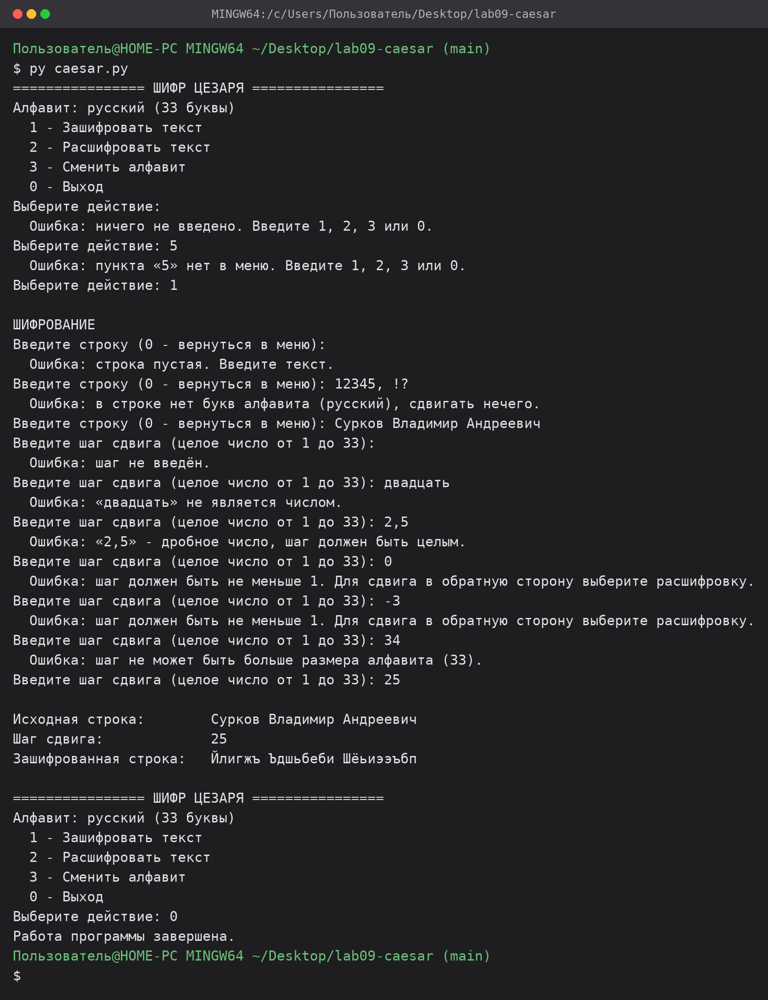
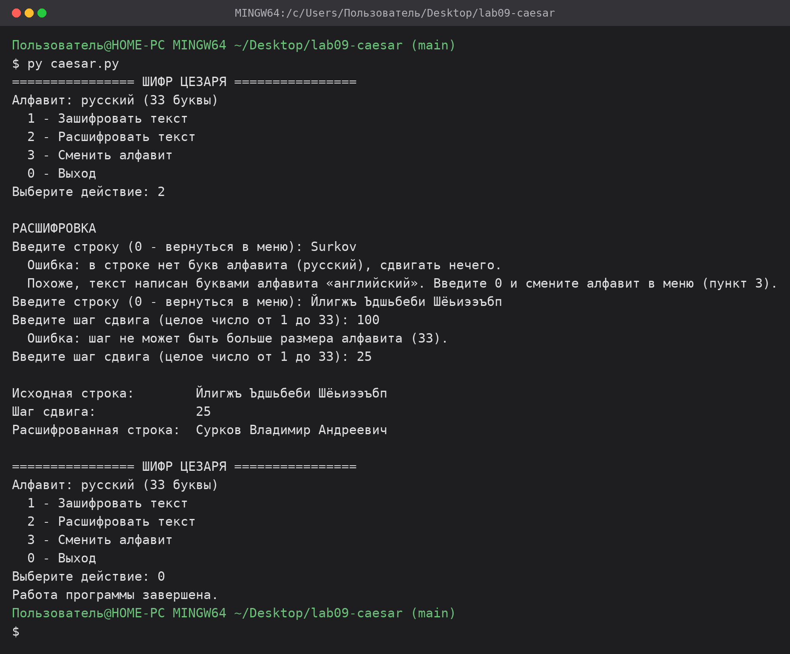
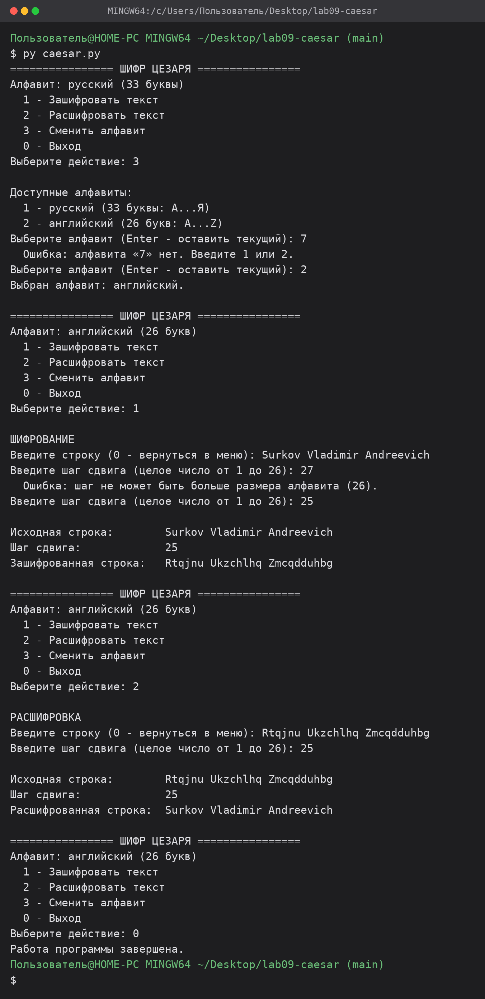

# Шифр Цезаря

## Исполнитель

Сурков Владимир Андреевич  
Группа Фт-250008

## Формулировка задания

Шифрование и расшифровка текста шифром Цезаря. Пользователь вводит строку и шаг сдвига.

Требования к программе:

- выбор действия (шифрование или дешифрование) осуществляется через меню;
- заглавные символы должны быть заменены заглавными;
- цифры, знаки препинания и все символы, отсутствующие в алфавите, остаются без изменения;
- шаг сдвига не должен быть больше размерности алфавита.

**Входные данные:** команда шифрования или дешифровки, исходная строка, размер сдвига.  
**Выходные данные:** зашифрованная или расшифрованная строка.

Программа должна вести качественный диалог с пользователем и обрабатывать ошибки ввода, чтобы неправильный ввод не приводил к отказу.

Тестирование: зашифровать, а затем расшифровать свои ФИО со сдвигом, равным номеру в списке группы (№ 25).

## Как работает шифр

Шифр Цезаря — шифр подстановки: каждая буква заменяется буквой, стоящей в алфавите на `k` позиций правее. Алфавит замкнут в круг: после последней буквы снова идёт первая. Номер новой буквы вычисляется как `(i + k) mod n`, где `i` — номер исходной буквы, `n` — размер алфавита. При расшифровке буквы сдвигаются на `k` позиций влево: `(i − k) mod n`.

Пример для русского алфавита и сдвига 3: А → Г, Б → Д, Я → В.

В программе есть два алфавита:

| Алфавит | Букв | Шаг сдвига |
| --- | --- | --- |
| русский (с буквой Ё) | 33 | от 1 до 33 |
| английский | 26 | от 1 до 26 |

Буквы выбранного алфавита сдвигаются с сохранением регистра. Все остальные символы — цифры, пробелы, знаки препинания и буквы другого алфавита — остаются без изменений.

## Среда разработки

Язык программирования: Python 3.13 (подходит Python 3.6 и новее).  
Среда разработки: Visual Studio Code (подойдёт любая среда для Python — PyCharm, IDLE, Visual Studio).  
Дополнительные библиотеки не требуются.

Проект состоит из одного файла — **`caesar.py`**, его и нужно открывать.

## Как запустить

```bash
git clone <ссылка на репозиторий>
cd <папка репозитория>
py caesar.py
```

На Windows программа запускается командой `py caesar.py` (или `python caesar.py`, если Python добавлен в PATH). В Visual Studio Code: открыть папку проекта, открыть `caesar.py` и нажать **Run → Run Without Debugging** (`Ctrl+F5`).

## Инструкция по работе

1. В меню выберите действие:

   | Пункт | Действие |
   | --- | --- |
   | `1` | зашифровать текст |
   | `2` | расшифровать текст |
   | `3` | сменить алфавит (русский / английский) |
   | `0` | выход из программы |

2. Введите строку. Чтобы вернуться в меню, не вводя текст, введите `0`.
3. Введите шаг сдвига — целое число от 1 до размера алфавита.
4. Программа выведет исходную строку, шаг сдвига и результат, после чего снова покажет меню.

По умолчанию выбран русский алфавит. Чтобы работать с латиницей, выберите пункт `3`, затем `2`. Прервать работу можно в любой момент сочетанием клавиш `Ctrl+C`.

## Надёжность работы программы

При любой ошибке ввода программа объясняет её причину и повторяет вопрос, не возвращая пользователя в начало.

| Ввод | Пример | Сообщение программы |
| --- | --- | --- |
| Пустой выбор в меню | — | ничего не введено, введите 1, 2, 3 или 0 |
| Несуществующий пункт меню | `5` | пункта «5» нет в меню |
| Несуществующий алфавит | `7` | алфавита «7» нет, введите 1 или 2 |
| Пустая строка | — | строка пустая, введите текст |
| Строка без букв алфавита | `12345, !?` | в строке нет букв алфавита, сдвигать нечего |
| Текст на другом языке | `Surkov` при русском алфавите | подсказка сменить алфавит в меню (пункт 3) |
| Пустой шаг | — | шаг не введён |
| Шаг — не число | `двадцать` | «двадцать» не является числом |
| Дробный шаг | `2,5` | дробное число, шаг должен быть целым |
| Ноль или отрицательный шаг | `0`, `-3` | шаг должен быть не меньше 1 |
| Шаг больше размера алфавита | `34`, `100` | шаг не может быть больше размера алфавита (33) |
| Шаг, равный размеру алфавита | `33` | предупреждение: полный круг, текст не изменится |
| Прерывание | `Ctrl+C`, `Ctrl+Z` | работа программы прервана пользователем |

## Результаты тестирования

Номер в списке группы — 25, поэтому шаг сдвига во всех тестах равен 25.

### Тест 1 — шифрование ФИО и ошибки ввода

В меню введены пустая строка и несуществующий пункт `5`. При вводе строки — пустая строка и строка без букв `12345, !?`. При вводе шага — пустой ввод, `двадцать`, `2,5`, `0`, `-3` и `34`. Каждая ошибка отклонена с пояснением. Затем ФИО зашифровано со сдвигом 25:

`Сурков Владимир Андреевич` → `Йлигжъ Ъдшьбеби Шёьиээъбп`

Заглавные буквы остались заглавными, пробелы не изменились.



### Тест 2 — расшифровка ФИО

Сначала введён текст латиницей `Surkov`: в нём нет русских букв, и программа подсказывает сменить алфавит. Затем введена строка, полученная в тесте 1, и шаг `100` (отклонён: больше 33). Со сдвигом 25 строка расшифрована обратно в исходное ФИО:

`Йлигжъ Ъдшьбеби Шёьиээъбп` → `Сурков Владимир Андреевич`



### Тест 3 — ФИО латиницей, смена алфавита

Через пункт меню `3` выбран английский алфавит (сначала введён несуществующий номер `7`). ФИО латиницей зашифровано со сдвигом 25 (шаг `27` отклонён: в английском алфавите 26 букв), а затем расшифровано обратно:

`Surkov Vladimir Andreevich` → `Rtqjnu Ukzchlhq Zmcqdduhbg` → `Surkov Vladimir Andreevich`


